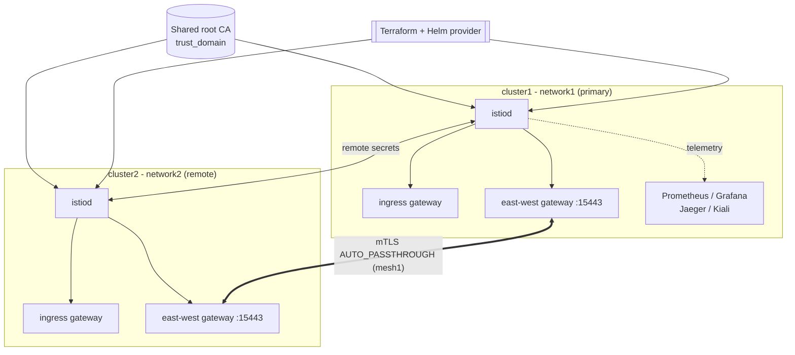

# Service Mesh Istio Platform

Platform-level automation for installing and operating an [Istio](https://istio.io)
service mesh across one or more Kubernetes clusters — control plane, gateways,
multi-cluster connectivity, and observability — all as code.

[](LICENSE)
[](https://github.com/abhisheksawant52/service-mesh-istio-platform/actions/workflows/ci.yml)
[](https://istio.io)
[](https://www.terraform.io)
[](https://helm.sh)

## Overview

`service-mesh-istio-platform` is the **platform / infrastructure** sibling of a
plain application-level `istio-config` repository. Where an app-config repo holds
`VirtualService` and `DestinationRule` traffic rules, this repo automates the
mesh *itself*: installing the control plane, wiring gateways, connecting clusters
into a single mesh, and standing up the telemetry stack.

Istio is installed via the official Helm charts, driven by Terraform's Helm
provider against an **existing** cluster. Mesh identity — `mesh_id`, `network`,
`cluster_name`, `trust_domain` — is defined once as Terraform variables and flows
consistently into the Helm value overrides and multi-cluster manifests.

It is aimed at platform and SRE teams who operate Istio as a shared service and
want a repeatable, reviewable install rather than hand-run `istioctl` commands.

## Architecture



Components:

- **Terraform root module** (`terraform/`) — installs `istio-base`, `istiod`, and
  the ingress `gateway` chart, and creates the `istio-system` namespace.
- **istio-addons module** (`terraform/modules/istio-addons`) — Prometheus,
  Grafana, Jaeger, and Kiali with per-addon toggles.
- **Helm value overrides** (`helm/values/`) — per-component config, including the
  multi-cluster `meshConfig` (meshID / multiCluster / network).
- **Multi-cluster manifests** (`multi-cluster/`) — east-west gateway,
  cross-network gateway Service, and service exposure resources.
- **Observability** (`observability/`) — mesh-wide `Telemetry` CR + addon values.

## Features

- One-command Istio install onto any existing cluster via Terraform + Helm.
- Multi-primary, multi-network topology: several clusters, one shared mesh.
- Cross-cluster connectivity through east-west gateways with SNI auto-passthrough.
- Automatic mTLS and a shared SPIFFE trust domain for workload identity.
- Pluggable observability stack (metrics, dashboards, tracing, topology).
- Per-environment (`dev` / `prod`) tfvars and partial remote-state backends.
- Green-realistic CI: `terraform fmt`, `validate`, `tflint`, and `yamllint`.

## Tech Stack

Istio 1.22 · Terraform >= 1.5 · Helm 3 · Kubernetes 1.27+ · Prometheus · Grafana
· Jaeger · Kiali · GitHub Actions

## Getting Started

### Prerequisites

- An existing Kubernetes cluster (v1.27+) and a kubeconfig context.
- Terraform >= 1.5.0, `kubectl`, and (for multi-cluster) `istioctl`.
- Cluster-admin on the target context.

### Configure

```bash
cd terraform
cp terraform.tfvars.example terraform.tfvars
# Edit: kube_context, istio_version, mesh_id, network, cluster_name, ...
```

### Install a single cluster

```bash
terraform init
terraform fmt -recursive -check
terraform validate
terraform plan  -var-file=environments/dev/dev.tfvars
terraform apply -var-file=environments/dev/dev.tfvars
```

This creates `istio-system` and installs the control plane, ingress gateway, and
observability addons. Enable sidecar injection per namespace:

```bash
kubectl label namespace my-app istio-injection=enabled
kubectl apply -f observability/telemetry.yaml
```

### Join a second cluster (multi-cluster)

```bash
# Apply the platform to cluster2 with its own network label.
terraform apply -var-file=environments/prod/prod.tfvars

# Wire east-west gateways and exchange endpoint-discovery secrets.
kubectl --context cluster1 apply -f multi-cluster/
istioctl create-remote-secret --context=cluster2 --name=cluster2 \
  | kubectl apply --context=cluster1 -f -
```

See [`docs/multi-cluster.md`](docs/multi-cluster.md) for the full procedure.

## Project Structure

```
.
├── terraform/                     # Root module: installs Istio via Helm provider
│   ├── main.tf                    # helm_release base/istiod/gateway + namespace
│   ├── variables.tf               # mesh identity, versions, enable flags
│   ├── outputs.tf
│   ├── versions.tf                # required_providers + backend (commented)
│   ├── providers.tf               # helm + kubernetes from kubeconfig context
│   ├── terraform.tfvars.example
│   ├── modules/istio-addons/      # Prometheus/Grafana/Jaeger/Kiali sub-module
│   └── environments/{dev,prod}/   # example tfvars + partial backend configs
├── helm/values/                   # per-component override values
├── multi-cluster/                 # east-west/cross-network gateways + exposure
├── observability/                 # Telemetry CR + addon values
├── docs/                          # architecture, multi-cluster, install
└── .github/workflows/ci.yml       # fmt / validate / tflint / yamllint
```

## Configuration

Set via `terraform.tfvars` (see [`terraform/variables.tf`](terraform/variables.tf)):

| Variable                  | Default          | Description                                          |
| ------------------------- | ---------------- | ---------------------------------------------------- |
| `kube_context`            | —                | kubeconfig context of the target cluster.            |
| `istio_version`           | `1.22.3`         | Istio chart/app version from the release chart repo. |
| `mesh_id`                 | `mesh1`          | Shared mesh identifier across all clusters.          |
| `network`                 | `network1`       | Per-cluster network label for cross-network routing. |
| `cluster_name`            | `cluster1`       | Cluster identifier registered with the mesh.         |
| `trust_domain`            | `cluster.local`  | Shared SPIFFE trust domain.                          |
| `revision`                | `default`        | Control-plane revision for canary upgrades.          |
| `enable_ingress_gateway`  | `true`           | Install the north-south ingress gateway.             |
| `enable_eastwest_gateway` | `false`          | Install the cross-cluster east-west gateway.         |
| `enable_addons`           | `true`           | Install the observability addons module.             |

## Deployment

Deployments are Terraform-driven and environment-scoped. Each cluster is applied
with its own tfvars and (optionally) a partial remote-state backend:

```bash
terraform init -backend-config=environments/prod/backend.hcl
terraform apply -var-file=environments/prod/prod.tfvars
```

Helm value overrides in [`helm/values/`](helm/values) and the observability
values in [`observability/`](observability) are the single source of truth for
component configuration and are consumed by both Terraform and manual
`helm upgrade --install` runs.

## Contributing

Contributions are welcome — see [CONTRIBUTING.md](CONTRIBUTING.md) and our
[Code of Conduct](CODE_OF_CONDUCT.md).

## Security

Please report vulnerabilities as described in [SECURITY.md](SECURITY.md).

## License

Released under the [MIT License](LICENSE).
