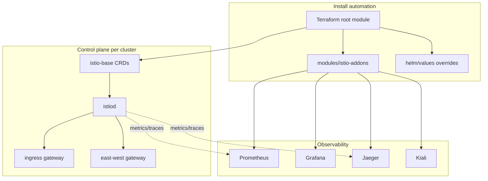

# Architecture

`service-mesh-istio-platform` is the **platform/infrastructure** layer of an
Istio deployment. It focuses on *installing and operating* the mesh across one
or more clusters — control plane, gateways, cross-cluster connectivity, and the
observability stack — rather than on application-level traffic rules.

## Layers

## Components

- **Terraform root module** (`terraform/`) — installs `istio-base`, `istiod`,
  and the ingress `gateway` chart via the Helm provider onto an existing
  cluster, and wires the mesh identity (`mesh_id`, `network`, `cluster_name`,
  `trust_domain`).
- **istio-addons module** (`terraform/modules/istio-addons`) — installs the
  observability stack (Prometheus, Grafana, Jaeger, Kiali) with per-addon
  toggles.
- **Helm value overrides** (`helm/values`) — per-component configuration kept in
  sync with the Terraform variables, including the multi-cluster `meshConfig`.
- **Multi-cluster manifests** (`multi-cluster/`) — east-west gateway, cross
  network gateway Service, and service exposure resources.
- **Observability** (`observability/`) — mesh-wide `Telemetry` CR plus addon
  value files.

## Design principles

- **Install-first**: the repo automates mesh lifecycle, not app routing.
- **Consistency**: mesh identity fields are defined once (Terraform variables)
  and flow into Helm values and manifests.
- **Multi-cluster ready**: a single root module is applied per cluster with
  different environment tfvars.
- **Secure by default**: automatic mTLS (`enableAutoMtls`), a shared SPIFFE
  trust domain, and least-privilege CI permissions.

See [`multi-cluster.md`](multi-cluster.md) for the cross-cluster topology and
[`install.md`](install.md) for the step-by-step install.
