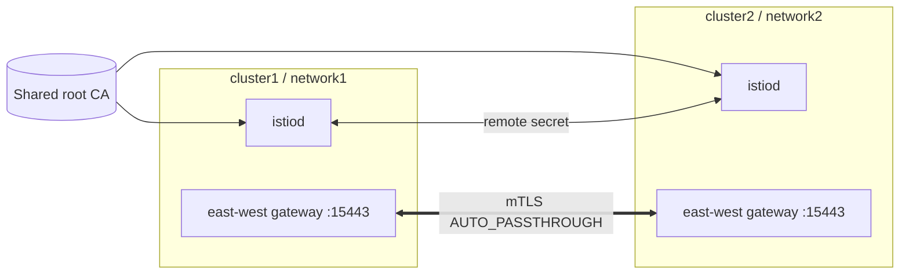

# Multi-Cluster Setup

This platform uses a **multi-primary on separate networks** topology: every
cluster runs its own istiod, all clusters share one mesh (`mesh_id = mesh1`) and
one `trust_domain`, and cross-cluster traffic flows through east-west gateways.



## 1. Shared trust

All clusters must chain to a common root CA so workload certificates are
mutually trusted under the same `trustDomain`. Create a per-cluster intermediate
CA secret named `cacerts` in `istio-system` **before** installing istiod:

```bash
kubectl --context "$CTX" create namespace istio-system
kubectl --context "$CTX" create secret generic cacerts -n istio-system \
  --from-file=ca-cert.pem \
  --from-file=ca-key.pem \
  --from-file=root-cert.pem \
  --from-file=cert-chain.pem
```

> Certificate material is never stored in this repo. Generate it with your PKI
> or the Istio `tools/certs` Makefile.

## 2. Install the mesh per cluster

Apply the Terraform config once per cluster with the matching environment
tfvars (differing by `cluster_name`/`network`, sharing `mesh_id`):

```bash
cd terraform
terraform workspace new dev  || terraform workspace select dev
terraform apply -var-file=environments/dev/dev.tfvars   # cluster1 / network1
terraform apply -var-file=environments/prod/prod.tfvars # cluster2 / network2
```

Set `enable_eastwest_gateway = true` for every participating cluster.

## 3. Wire the east-west gateways

Apply the manifests in [`multi-cluster/`](../multi-cluster) on each cluster and
label the control-plane namespace with the cluster network:

```bash
kubectl --context cluster1 label namespace istio-system \
  topology.istio.io/network=network1 --overwrite
kubectl --context cluster1 apply -f multi-cluster/
```

## 4. Enable endpoint discovery (remote secrets)

Give each istiod read access to its peers' API servers with `istioctl`:

```bash
istioctl create-remote-secret --context=cluster2 --name=cluster2 \
  | kubectl apply --context=cluster1 -f -
istioctl create-remote-secret --context=cluster1 --name=cluster1 \
  | kubectl apply --context=cluster2 -f -
```

## 5. Verify

```bash
istioctl --context cluster1 remote-clusters
istioctl --context cluster1 proxy-config endpoints deploy/istiod -n istio-system
```

Endpoints from the peer cluster should appear with the peer's `network` label,
confirming cross-network load balancing is active.
